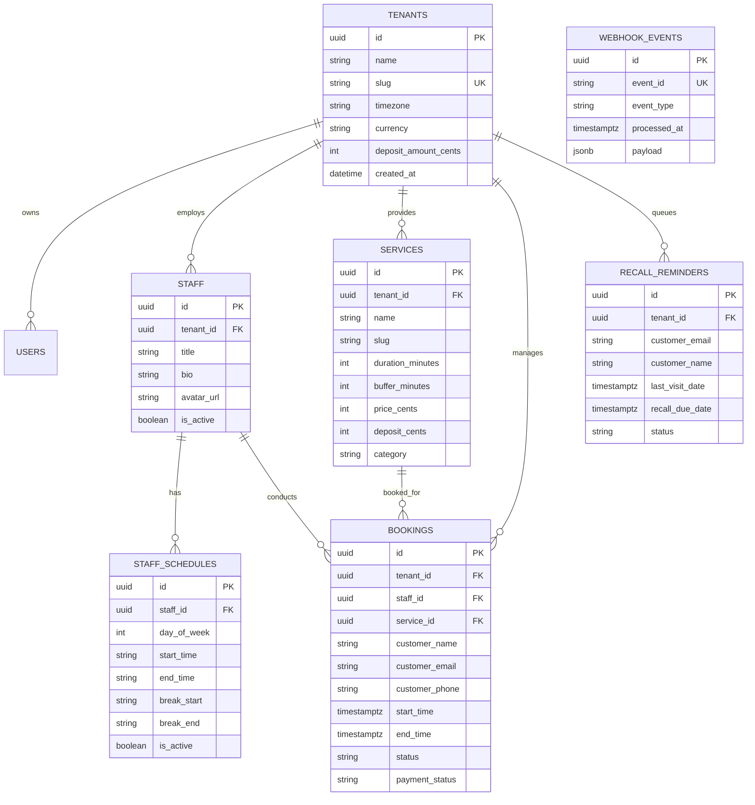

# DentalBook — Multi-Tenant Clinical Booking & Operations SaaS

A multi-tenant booking and clinic operations platform built with Next.js 14, TypeScript, PostgreSQL, and Drizzle ORM. Designed to prevent double bookings using PostgreSQL row-level locking, enforce room sterilization buffers between appointments, handle idempotent Stripe deposit webhooks, and manage patient follow-ups.

## Live Showcase Routes

* **Live Demo:** https://zenith-dental-studio-sage.vercel.app/
* **Public Clinic Storefront:** `/b/zenith-dental` (English, Azerbaijani, Russian)
* **Staff & Operations Dashboard:** `/dashboard`
* **Patient Self-Service Portal:** `/manage`
* **Preventive Recall Claim Portal:** `/recall`
* **Multi-Tenant Onboarding Wizard:** `/onboarding`

## Tech Stack

* **Framework:** Next.js 14 (App Router, Server Components, Route Handlers), React 18, TypeScript
* **Styling:** Tailwind CSS
* **Database & ORM:** PostgreSQL (`pg`), Drizzle ORM, WASM `PGlite` (zero-setup local dev & test runtime)
* **Validation & Auth:** Zod, `bcryptjs`, `httpOnly` signed session cookies
* **Payments & Email:** Stripe (idempotent webhook processing), Nodemailer (SMTP with `.ics` calendar attachments & safe test-domain simulation)

## System Architecture



## Core Features

1. **Availability & Sterilization Buffer Engine (`src/lib/engine/availability.ts`)**
   * Computes available slots from staff shifts, lunch breaks, existing bookings, and a 15-minute post-treatment room sterilization buffer.
   * Respects clinic timezones independently of server locale and expires unpaid pending holds after a configurable TTL.

2. **Concurrency-Safe Booking Reservation (`src/lib/engine/booking.ts`)**
   * Wraps slot verification and insertion in a database transaction with `SELECT ... FOR UPDATE` row-level locking to block simultaneous double bookings.
   * Generates cryptographic `ZD-*` booking codes with automatic `23505` unique-constraint retry handling.

3. **Idempotent Stripe Webhooks (`src/lib/stripe/webhook.ts`)**
   * Verifies Stripe signatures (fail-closed when `STRIPE_WEBHOOK_SECRET` is missing) and records processed event IDs in `webhook_events` so duplicate webhook deliveries return `200 OK` without double-crediting deposits.

4. **Multi-Step Patient Booking Flow (`src/components/booking/`)**
   * 5-step booking modal (`Step1ServiceDoctor` -> `Step2DateSlot` -> `Step3PatientInfo` -> `Step4PaymentDeposit` -> `Step5Confirmation`) with Zod validation, `.ics` calendar export, and EN/AZ/RU localization.

5. **Modular Clinic Operations Dashboard (`src/components/admin/`)**
   * Split into 13 focused modules: schedule calendar grid, appointments ledger, 6-month recall queue, revenue analytics with CSV export, clinical dossier drawer (32-tooth odontogram, treatment plan estimator), clinical prescription modal, WhatsApp reminder preview, and practice settings.

6. **Multi-Tenant Onboarding (`/onboarding`)**
   * Interactive 4-step clinic setup wizard with live mobile preview and tenant theme configuration.

## Engineering Challenges & Solutions

* **Double-Booking Race Conditions:** Standard read-then-write checks fail under concurrent requests for the same doctor and slot. **Solution:** Enforced PostgreSQL `FOR UPDATE` row-level locking inside the booking transaction and verified it with a 50-request parallel stress test (1 confirmed, 49 rejected with `409 Conflict`).
* **Duplicate Stripe Webhook Retries:** Network retries from Stripe can replay payment events and credit deposits twice. **Solution:** Indexed processed Stripe Event IDs in `webhook_events` so replays short-circuit safely while keeping signature verification fail-closed.
* **Monolithic UI Scaling:** As dashboard and booking features grew, `dashboard/page.tsx` (3,284 lines) and `BookingModal.tsx` (1,339 lines) became difficult to maintain. **Solution:** Refactored them into 13 admin modules and 5 booking step components, reducing the entry files by 75% and 46% respectively.
* **Zero-Config Local Dev vs. Production DB:** Requiring Docker/PostgreSQL locally slowed down quick setup and automated tests. **Solution:** Paired Drizzle ORM with WASM `PGlite` for instant zero-setup local dev and unit tests while keeping full PostgreSQL compatibility in production.

## Quickstart

### Local Development (WASM PGlite — No DB Setup Required)

```bash
npm install

# Run automated tests
npx tsx tests/concurrency.test.ts
npx tsx tests/availability.test.ts
npx tsx tests/webhook.test.ts

# Start dev server
npm run dev
# Open http://localhost:3000/b/zenith-dental
```

### Docker Compose (PostgreSQL 16 + Redis)

```bash
docker-compose up -d
npm run dev
```

## API Routes

* `GET / POST /api/v1/tenants` — List or register dental practice tenants
* `GET /api/v1/tenants/[slug]` — Fetch tenant specialists, services, and schedule config
* `GET /api/v1/availability` — Compute available slots with sterilization buffers
* `GET / POST / PATCH / DELETE /api/v1/bookings` — Tenant-scoped booking management with concurrency locking
* `POST /api/v1/webhooks/stripe` — Signature-verified, idempotent Stripe webhook handler

## Automated Tests

| Test Suite | Command | Coverage |
| :--- | :--- | :--- |
| Concurrency & Locking | `npx tsx tests/concurrency.test.ts` | 50 parallel requests (1 win, 49 `409 Conflict`), sterilization buffers, `23505` retry, unpaid TTL |
| Availability Engine | `npx tsx tests/availability.test.ts` | Shifts, lunch breaks, closed days, timezone parity, tenant isolation |
| Stripe Webhooks | `npx tsx tests/webhook.test.ts` | Missing secret fail-closed, signature validation, replay idempotency |
| Multi-Tenant API | `npx tsx tests/stripe-webhook.test.ts` | Route-level webhook state machine & edge cases |
